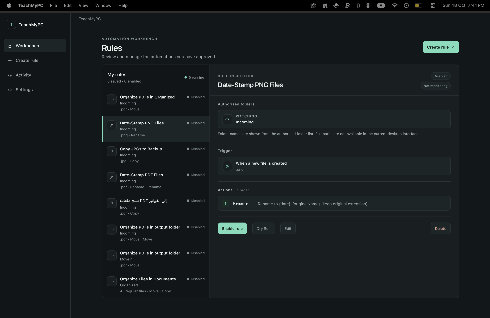
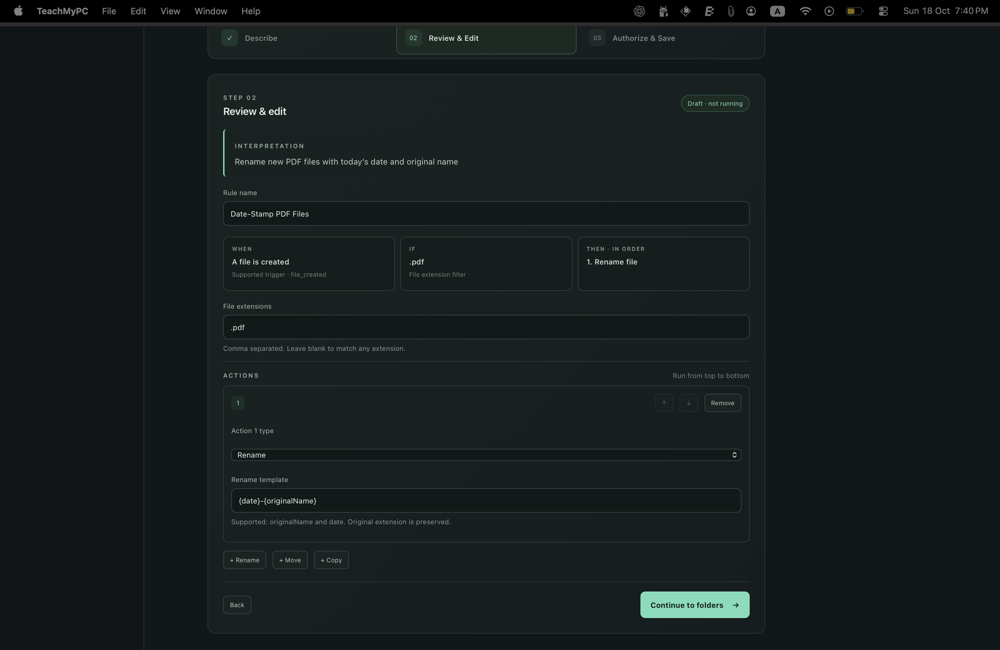
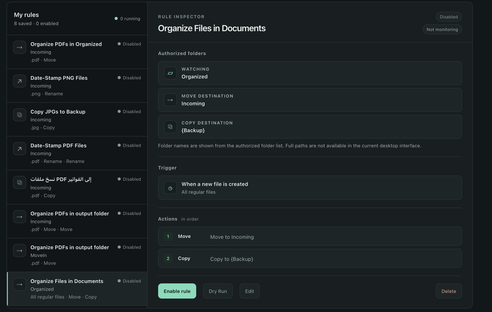
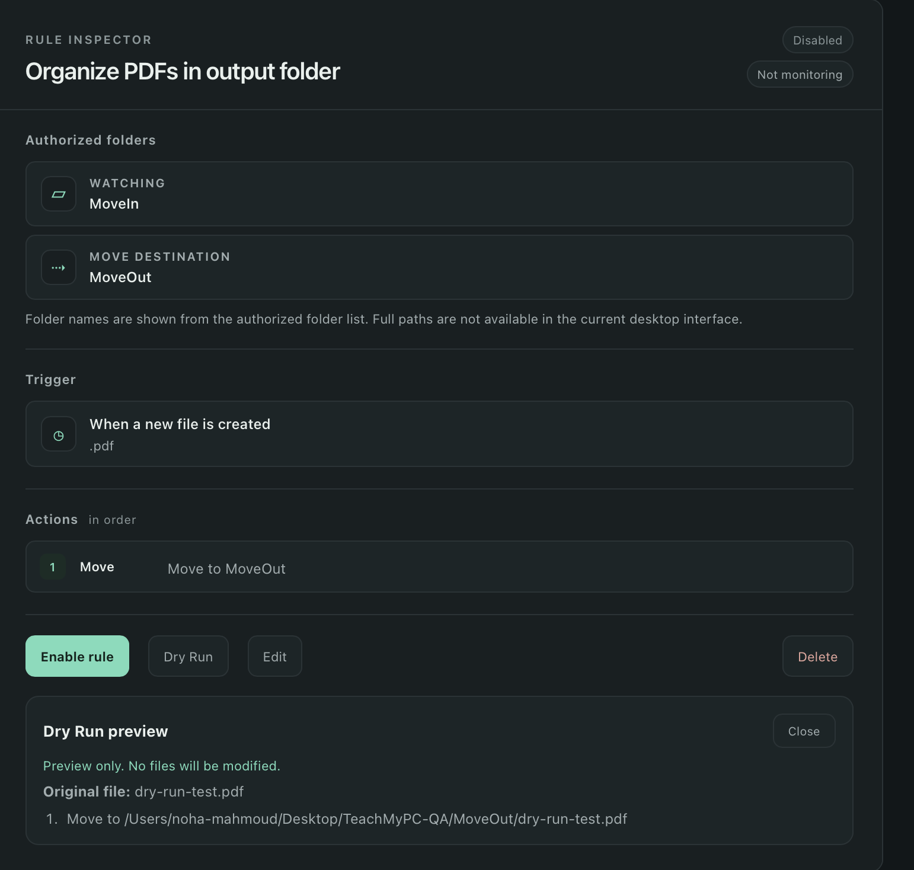
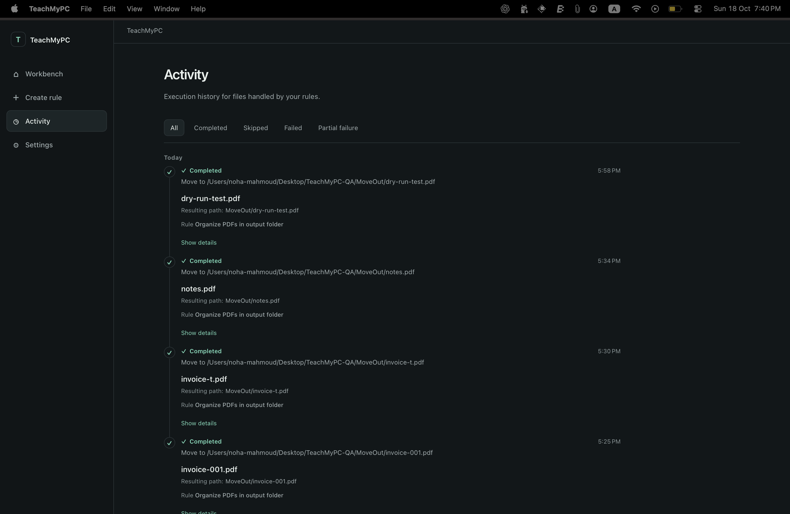
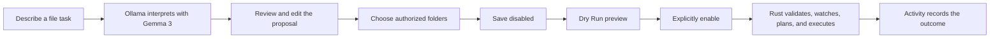

# TeachMyPC


**Put repetitive file organization on autopilot, without writing a script.**

Sorting downloads or renaming a pile of files is the kind of small chore that keeps coming back. TeachMyPC lets you describe that task in plain language, review the rule it proposes, choose the folders it may access, and explicitly enable it when you are ready.

TeachMyPC is a macOS-first desktop MVP. Rule interpretation runs through Gemma 3 4B on your local Ollama installation. A Rust backend validates the proposal and plans and performs approved file operations.

## App Preview

The screenshots below are from the native macOS app.

**Workbench** — Review saved rules, their status, authorized folders, triggers, and actions.



| Create Rule | Rule Details |
| --- | --- |
| <br><sub>Describe a task, review its interpretation, and configure its actions.</sub> | <br><sub>Inspect a saved rule and choose when to enable or disable it.</sub> |

| Dry Run | Activity |
| --- | --- |
| <br><sub>Preview the planned move for a sample PDF without modifying the file.</sub> | <br><sub>Review completed automations, resulting files, and recorded outcomes.</sub> |

For the complete walkthrough and safe demo setup, see [docs/DEMO_GUIDE.md](docs/DEMO_GUIDE.md).

## What it can do

- Turn natural-language instructions into a reviewable rule proposal using local Gemma 3 through Ollama.
- Watch for newly created regular files and filter by file extension.
- Rename, move, or copy matching files. A rule can contain an ordered sequence of actions.
- Let you choose source and destination folders with the native folder picker.
- Save rules disabled by default; enabling a rule requires an explicit confirmation.
- Preview the planned operation with **Dry Run** without changing files.
- Enable or disable rules from Workbench.
- View recorded successes, skips, partial failures, and failures in Activity.
- Check the local Ollama endpoint and whether `gemma3:4b` is available in Settings.

## How it works



The model proposes structured rule data. It does not get to perform file operations or choose filesystem paths. The Rust backend validates the rule and the selected folders, then deterministically plans and executes supported actions. TeachMyPC does not execute model-generated shell commands.

## Tech stack

- **Angular and TypeScript** for the desktop interface.
- **Tauri 2 and Rust** for the desktop runtime, local storage, folder authorization, validation, and filesystem operations.
- **Ollama with Gemma 3 4B (`gemma3:4b`)** for local rule interpretation.
- **Tauri Dialog plugin** for native folder and sample-file selection.

See [docs/ARCHITECTURE.md](docs/ARCHITECTURE.md) for the frontend, Tauri, and Rust responsibilities and their data flow.

## Download the preview release

Download the macOS DMG from the [TeachMyPC v0.1.0 GitHub Release](https://github.com/NohaFahmi/teach-my-pc/releases/tag/v0.1.0). Choose the artifact marked **Apple Silicon (arm64)**. This preview provides an arm64 build only; Intel Macs are not supported by this artifact. The app has been built on macOS 26.5 and has not been verified on older macOS versions.

### Install on macOS

1. Open the downloaded `.dmg` and drag **TeachMyPC** into **Applications**.
2. Eject the mounted disk image, then open TeachMyPC from Applications.
3. This preview is not signed with an Apple Developer ID and is not notarized. macOS may block the first launch. If so, Control-click the app in Applications, choose **Open**, then confirm **Open** in the dialog. If macOS still blocks it, use **System Settings → Privacy & Security → Open Anyway** after attempting to launch it. Only install builds downloaded from the project's GitHub Releases.

### Set up Ollama

Install [Ollama for macOS](https://ollama.com/download), open it, and install the required model in Terminal:

```sh
ollama pull gemma3:4b
```

TeachMyPC checks Ollama at `http://127.0.0.1:11434` and looks for `gemma3:4b`. Keep Ollama running while interpreting rules. In TeachMyPC, open **Settings** and confirm that the service and model are available before creating a rule.

### First run

Open **Create Rule**, describe one file task, and inspect the proposed trigger and actions. Choose the allowed folders using the folder picker, save the rule, then use **Dry Run** with a disposable sample file. Rules are saved disabled. Enable one only after reviewing the preview and confirming the prompt. See [docs/DEMO_GUIDE.md](docs/DEMO_GUIDE.md) for a safe walkthrough.

### Supported platforms and release limitations

- macOS on Apple Silicon (`aarch64` / `arm64`) is the only packaged and verified target for v0.1.0.
- No Intel (`x86_64`) or universal DMG is included. A universal build requires both Rust macOS targets and a separate build verification.
- No Windows or Linux packages are provided. Their native file-picker and automation behavior has not been validated.
- This release has no Apple Developer ID signature and is not notarized. Gatekeeper may require the manual first-launch steps above, and the app may not open on managed Macs that prohibit apps without Developer ID signatures.
- Ollama and `gemma3:4b` are separate prerequisites; neither is bundled. The service URL and model are fixed in this release.
- The app has only been verified on macOS 26.5. The minimum supported macOS version has not been established.

## Development setup

### Prerequisites

- macOS with Xcode Command Line Tools.
- Node.js 24 LTS and npm.
- Rust stable with the macOS target installed.
- [Ollama](https://ollama.com/download) installed and running locally.

### Install Ollama and the model

Start Ollama if it is not already running, then pull the model:

```sh
ollama serve
ollama pull gemma3:4b
```

Ollama listens locally at `http://127.0.0.1:11434`. Settings in TeachMyPC shows whether Ollama is reachable and the model is installed.

### Install and run TeachMyPC

From the repository root:

```sh
npm ci
npm run tauri:dev
```

The development command starts the Angular frontend and Tauri desktop app. For browser-only frontend development, use `npm start`. To build a desktop bundle, use `npm run tauri:build`.

## Try it yourself

Use disposable files in a temporary directory. Create `~/TeachMyPC-Demo/Incoming` and `~/TeachMyPC-Demo/Organized`, then put a sample PDF in `Incoming`. Select these folders in TeachMyPC and enter:

> Move new PDF files to the Organized folder.

Review the proposed file-created trigger, `.pdf` extension, and move action. Choose `Incoming` as the source and `Organized` as the destination, then save the rule. It will remain disabled.

In Workbench, select the rule and choose **Dry Run**. Pick the sample PDF from `Incoming` to see the planned move; Dry Run does not modify the file. When the preview looks right, choose **Enable rule** and confirm. A newly added PDF that remains in the source folder while the watcher scans can then be moved, with its outcome shown in Activity. Disable the rule when you finish.

The [demo guide](docs/DEMO_GUIDE.md) has a full timed walkthrough and troubleshooting notes.

## Safety and privacy

- Rule interpretation uses Ollama at the local endpoint `127.0.0.1`; the app is designed not to send rule data to a cloud service.
- You choose the source and any move or copy destination folders with a native picker. The model's suggested folder names do not authorize filesystem access.
- Saving a rule does not start it. Rules begin disabled, and enabling requires confirmation.
- Dry Run uses the same deterministic planner as execution and previews actions without modifying files or creating an Activity record.
- The backend accepts regular files inside the authorized source folder, ignores symlinks and directories, and rejects destination collisions. Cross-volume moves are rejected. Copy uses a temporary file and no-overwrite finalization.
- Automation is not risk-free: filesystem changes made by a multi-action rule are not rolled back if a later action fails. Review the proposal, test it with disposable files, and monitor Activity.

## Current limitations

- TeachMyPC is a macOS-first MVP, not a production-ready automation platform. The local Ollama endpoint and model are currently fixed.
- The only trigger is detection of newly created files in a selected source folder. The watcher polls every 500 ms, is non-recursive, and can miss a file created and removed between scans. File stability is checked by size.
- Supported actions are rename, move, and copy. Deletion, shell commands, and other automation types are not supported.
- Rename templates support `{originalName}` and `{date}`; the original extension is preserved. Move operations across filesystem devices are rejected.
- Multi-action rules stop at the first failure, but completed earlier actions are not rolled back. Filesystem checks do not guarantee race-free behavior under every concurrent filesystem change.
- A rule interpretation may need clearer wording or manual correction. Always inspect the proposed trigger and actions before saving.

## Development checks

Run the frontend production build and tests:

```sh
npm run build
npm run test -- --watch=false
```

Run the Rust checks:

```sh
cargo check --manifest-path src-tauri/Cargo.toml
cargo test --manifest-path src-tauri/Cargo.toml
```
